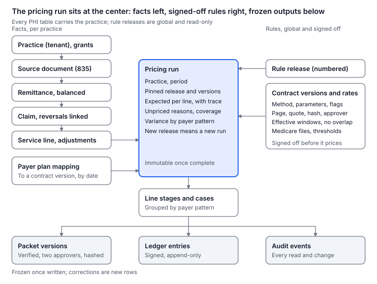
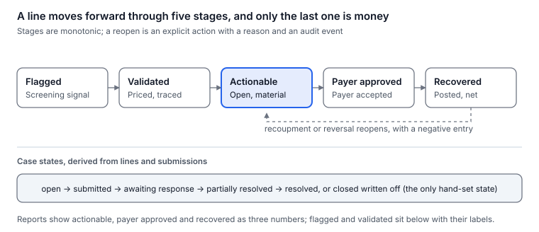
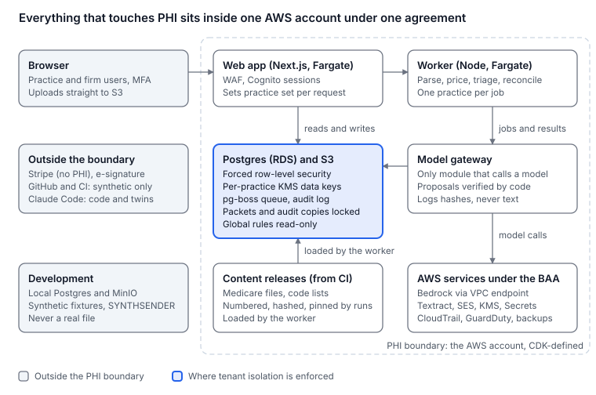

# Therapy Contract-Payment Platform: Architecture and Build Plan

As of 2026-10-14. Imported verbatim from the "Build plan" tab of the planning document.

The build specification for the contract-payment verification platform for outpatient therapy practices and their billing firms: every user, journey, screen, record, rule, engine, control and milestone, written so Claude Code can build it one checked milestone at a time.

## 1. Summary

Build a web application that takes copies of a therapy practice's 835 remittance files and its payer contracts, computes what each paid service line should have paid under the approved contract version, groups the shortfalls by payer pattern, turns each pattern into a dispute packet a person approves, and proves what came back by reconciling later remittances to payment posting and bank deposits. A billing firm runs the same product across every practice that grants it access. Nothing in the system that produces a dollar figure is a model; nothing that leaves the system is unreviewed; nothing is called recovered until the money has posted.

**Four rules that shape every file in the repository**

1. Code computes every number. Models read documents and draft text; a person approves every proposal before it is used. An unknown or ambiguous term makes a line unpriced, with a reason, never a guess.
2. Money is integer cents; rates are decimals; rounding happens once per line under the contract's rule, and the unrounded value is kept beside the rounded one.
3. Every expected amount traces to a versioned rate record with a source page, a hash and an approver, and to a numbered rule release. Pricing runs pin both and are replayable.
4. Every table that can hold protected health information carries `practice_id` and a forced row-level security policy. The application's database role cannot bypass it, and a cross-tenant test proves it on every pull request. No real PHI ever enters a development tool, the repository, a fixture or a log.

**What ships, in order**

| Release | What a customer gets | Target |
| --- | --- | --- |
| Audit v0 | Secure intake, the 835 parser, the contract repository, anomaly screening, a human-reviewed audit report, the five-stage status ledger. Delivered as a paid look-back by the founder using the product internally | First three audits by July 2027 |
| Monitoring v1 | The expected-payment engine, monthly runs on new files, the workbench, dispute packets with citations and traces, the recovery ledger reconciled to posting and EFT, customer sign-in | Five groups and one firm by March 2028 |
| Firm v1.5 | Firm organizations, practice grants with expiry and revocation, portfolio views, per-practice billing, white-label report marks | 2028 |
| Intelligence v2 | Contract calendars and renewal alerts, the negotiation workspace, opt-in payer-behavior scorecards under reviewed data rights | After repeatable monitoring revenue |

**The stack in one line.** One TypeScript monorepo (pnpm): Next.js for the interface and API, a Node worker on a Postgres-backed queue, PostgreSQL with forced row-level security, S3 with per-practice envelope encryption under KMS, Cognito for identity with MFA, Claude on Bedrock for the model gateway, everything on AWS under its business associate agreement, defined in CDK.

**Effort and dates.** About 900 to 1,300 hours across fourteen milestones (section 17), at 13 hours a week from the week of October 19, 2026 until the full-time trigger and then faster. At that pace milestones 0 to 6 complete between June and October 2027; the three paid audits due by July 15, 2027 are run by hand on the parser and the contract repository as those land, and the app reproduces them at milestone 6. Monitoring v1 lands between December 2027 and June 2028 at 13 hours a week, or by March 2028 if the full-time trigger fires at the start of 2028 as the execution plan expects. The gates that decide whether each stage is funded are the ones in the execution plan this document implements; this document does not restate them, it builds what they require.

**How Claude Code uses this document.** Sections 2 and 8 through 16 are the specification; section 17 is the order and the checks; the Starter kit tab holds the configuration files, hooks, skills, reviewer agents and the opening prompt for each milestone; the Data dictionary tab is the schema in field-level detail; the Rules reference tab is the reimbursement logic with its sources; the Test matrix tab is the list of cases every release must pass. Each milestone session starts by reading the summary, its own section and its prompt, and ends when its check passes.

## 2. What the engine must get right

Two bodies of knowledge sit under every number: how therapy services are paid, and what an 835 remittance actually says. Both are encoded as versioned content and tested against hand-computed cases; neither is ever left to a model. The Rules reference tab carries the parameters and sources in full; this section is what the engineer must hold in mind.

### Therapy reimbursement, in the order the engine applies it

1. **Which agreement governs the line.** Payer, plan or product, network status, the billing entity and provider, the service date and the place of service identify exactly one contract version, or none. A line with no identified agreement is unpriced with reason `NO_AGREEMENT`, never priced from a guess.
2. **The rate method of that agreement.** Fixed schedule per code and modifier; a percentage of the Medicare physician fee schedule, either locked to a stated year or floating with the current year; lesser of billed charges and the schedule; a flat per-visit rate; or an unsupported method (capitation, case rates the contract does not define), which leaves the line unpriced with reason `UNSUPPORTED_METHOD`.
3. **The Medicare fee schedule, when the method references it.** The relative value units, the geographic practice cost indices for the locality, and the conversion factor for the year the contract names. For 2026 there are two conversion factors (qualifying alternative payment model participants and everyone else); the rule record says which applies. The amount is RVU work times the work index plus RVU practice expense times the practice-expense index plus RVU malpractice times the malpractice index, times the conversion factor, with the facility or non-facility practice-expense value chosen by place of service.
4. **Medicare adjustments, only where the agreement incorporates them.** The multiple procedure payment reduction cuts the practice-expense portion of the second and later "always therapy" units in a day by 50%; the CQ and CO modifiers (services furnished in whole or part by physical or occupational therapist assistants) pay at 85% of the otherwise applicable amount; sequestration takes 2% of the Medicare payment after the beneficiary share; the KX threshold ($2,480 for PT and SLP combined and $2,480 for OT in 2026, with targeted medical review at $3,000) is a documentation rule the engine checks, not a price change ([CMS therapy services](https://www.cms.gov/medicare/coding-billing/therapy-services)). A commercial payer applies these only if its contract says so; the rule record carries a flag per adjustment and the default is off.
5. **Medicare Advantage, two cases.** A contracted MA plan is a commercial contract and prices under its own terms. A non-contracting provider must accept, as payment in full, the amount it could have collected under Original Medicare, with a deemed request when the provider bills the same information it would bill Medicare ([42 CFR 422.214](https://www.ecfr.gov/current/title-42/chapter-IV/subchapter-B/part-422/subpart-E/section-422.214)); those lines price from the public fee schedule with no contract on file, which makes the Medicare Advantage book the first thing every audit can price completely. A reimbursement specialist confirms the regulation's application to each case before a packet goes out.
6. **Units and edits.** Units are taken as billed. The 8-minute rule (Medicare pools timed minutes across codes; many commercial payers count per code) is checked only when minute logs are imported, and until then it is a reason for review, not a price. National Correct Coding Initiative procedure-to-procedure and medically unlikely edits apply where the agreement incorporates them; 97140 with 97530 on the same day needs a 59 or X modifier under those edits.
7. **Patient responsibility and secondary payers.** The patient share comes from the remittance's PR adjustments, and expected allowed is compared with observed allowed, not with paid alone. Secondary and tertiary payers, workers' compensation and auto are unpriced in v0 and v1 with reason `SECONDARY_PAYER`.
8. **Windows.** Timely filing (Medicare 12 months) and dispute or appeal windows (Medicare redetermination 120 days, reconsideration 180; commercial windows from the contract) decide whether a validated discrepancy is actionable.
9. **Interest.** Where a state prompt-pay statute applies to the payer (North Carolina's requires payment or a response within 30 days and automatic interest on late payment, with self-funded ERISA plans excluded, per the [NC Department of Insurance](https://www.ncdoi.gov/insurance-industry/form-and-rate-filings/life-and-health/prompt-pay-requirement)), the packet states the interest exposure as a separate line, computed by code from a state rule record.

### The 835, as the parser must read it

An 835 (version 005010X221A1, read against the purchased implementation guide) is one interchange (ISA, with the control number in ISA13) holding one or more transaction sets (ST), each one payment: BPR carries the payment amount, method and date; TRN02 carries the check or EFT trace number that reassociates the remittance with the bank deposit ([CMS, ERA and EFT](https://www.cms.gov/priorities/key-initiatives/burden-reduction/administrative-simplification/transactions/health-care-payment-remittance-advice-electronic-funds-transfer)); N1 loops name the payer and payee; LX loops hold claims. Each CLP has the patient control number, the claim status (1 processed as primary, 2 secondary, 3 tertiary, 4 denied, 22 reversal of a prior payment, and others), total charge, total paid, patient responsibility, the payer's claim control number and the facility type. Under it, CAS segments carry adjustments by group (CO contractual, PR patient responsibility, OA other, PI payer-initiated) with reason codes and amounts; NM1 segments identify the patient and insured; REF and DTM carry references and dates; AMT with qualifier AU carries the claim-level allowed amount. Each SVC carries the procedure and modifiers, the line charge and paid amount, units, and its own CAS adjustments, with AMT B6 as the line allowed amount where the payer sends it. PLB segments at the end carry provider-level adjustments: recoupments, forward balances, interest and other amounts that make the check total differ from the sum of claims.

What follows from that for the engine: observed allowed is AMT B6 where present and otherwise paid plus PR adjustments; a reversal (CLP02 of 22) carries negative amounts and is matched to the claim it reverses and usually followed by a corrected claim; a check balances only when claim totals plus PLB adjustments equal BPR02, and a file that does not balance is held, not loaded; the same remittance can arrive twice (resent files, two downloads), so the unit of idempotency is the sender, ISA13 and TRN02 together with the file hash; and front-end rejections never appear in an 835 at all, so the product never claims to see every denial.

### What the engine never does

It never prices a line whose agreement, method, effective date or plan is uncertain; never applies a Medicare adjustment to a commercial line unless the contract flag is set; never infers a clinical fact; never treats the most common allowed amount as a contract; and never reports a dollar as recovered on the strength of a packet having been sent.

## 3. Users, roles and tenancy

The practice is the tenant because the practice is the covered entity whose data this is. Everything else (billing firms, the company's own staff, a PE platform) reaches a practice's data through an explicit, expiring, revocable grant that the practice's own administrator approved. A firm that pays for the product still does not own the practice's workspace, which is what makes it possible for a practice to change firms without losing its contracts, cases and ledger.

### The model

| Record | What it is | Rules |
| --- | --- | --- |
| Practice | The tenant. Every row that can hold PHI carries its ID | Has at least one practice administrator at all times, even when a firm pays; has its own KMS data key; owns its agreements |
| Organization | The account that signs a contract: a practice group, a billing firm, or the company itself (internal) | Pays the invoices; holds memberships; has a kind (`group`, `firm`, `internal`) |
| Membership | A user's role inside an organization | One role per membership; a user may belong to several organizations |
| Grant | An organization's access to a practice: scope, start and end dates, the practice administrator who approved it, the agreement ID it rests on | Effective permission is the membership role intersected with the grant scope; ends on expiry or revocation at once; every grant change is audited and visible to the practice |
| Agreement | A signed document the chain rests on: BAA, engagement letter, terms, data-rights addendum | Stored by reference and hash; version and signer recorded; a grant cannot exist without one |

A practice group with five locations is one organization with one practice per billing entity (usually one per tax ID; locations are attributes of claims, not tenants). A billing firm is one organization with grants to each client practice. The company's internal organization has grants only through the support path below.

### Personas and what each can do

| Persona | Organization | Does | Must not |
| --- | --- | --- | --- |
| Practice administrator | Practice group | Signs agreements, invites users, approves and revokes grants, requests export or deletion, reads the access log | Edit rate records (that is the specialist's job) |
| Billing manager | Practice group or firm | Uploads files, maps payer plans, works anomalies and cases, builds and approves packets, logs submissions, reconciles postings | Approve a packet she drafted (two-person rule where the practice has two users; otherwise a 24-hour delay and an audit flag) |
| Analyst | Practice group or firm | Works cases, drafts packets, uploads files | Approve packets, change grants |
| Viewer (CFO, owner) | Practice group or firm | Reads dashboards, reports, the ledger and ROI statements | Export line-level PHI |
| Firm principal | Firm | Everything a billing manager does across granted practices; manages firm users; sees the portfolio; is billed | Act in a practice whose grant has expired |
| Contract specialist | Internal | Reviews model-proposed contract abstractions, approves rate records for publication, answers pricing questions | Edit a published rate version (a new version supersedes it) |
| Reimbursement reviewer | Internal or contracted | Independently validates audit findings against contracts before an audit report is released | Edit anything; read-only with a signed attestation |
| Platform administrator | Internal | Manages organizations, agreements, rule releases, feature flags, billing | Read PHI without a support grant |
| Support engineer | Internal | Break-glass access to one practice for one ticket: time-boxed, reason recorded, practice administrator notified | Retain access after the ticket closes |

### Authorization, in code

- Identity is Cognito with MFA required for every user and hardware keys required for internal roles.
- Every request resolves the user's memberships and the grants in force, producing an allowed-practice set; the server opens its database transaction with `SET LOCAL app.practice_ids` to that set and `app.actor_id` to the user, and every PHI table's policy is `practice_id = ANY(current_setting('app.practice_ids')::uuid[])`. Portfolio queries across a firm's practices run inside the same policy, which is why a firm never needs a bypass.
- Role checks live in the route handlers and server actions, never only in middleware (the 2025 Next.js middleware bypass is the reason), and again in the database as policies on the few actions that are role-specific (packet approval, grant changes).
- Internal roles have no standing access to PHI. Support access creates a grant with a ticket number, a reason, a four-hour expiry and an automatic notice to the practice administrator; every read under it is logged.
- Service accounts (the worker, the model gateway) run under the same practice-scoped transactions, one practice per job.

### Lifecycle events the model must handle

A practice joins a firm (grant created, agreement referenced, scope chosen); a practice leaves a firm (grant ended; the firm's sessions lose access within one request; the practice's data stays; open cases are reassigned to the practice's own users or left unassigned with a notice); a firm adds a new client practice (the practice administrator, not the firm, accepts the invitation and approves the grant); a user leaves a firm (memberships ended, sessions revoked); a practice churns (export delivered, deletion scheduled under the retention policy, the data key destroyed at the end of it); the company itself needs a practice's data for support (the support path, never a direct query).

## 4. Scope by release

Each release is the smallest thing that can be sold at its stage. Features move earlier only when a paying customer needs them; nothing moves later once a customer depends on it.

### Audit v0 (internal tool plus a report)

| Included | Excluded |
| --- | --- |
| Practice and organization records; internal users only | Customer sign-in |
| Secure intake of 835 copies, contract PDFs and fee-schedule exhibits, posting exports | Any integration |
| The 835 parser with balancing, reversals, PLB and deduplication | 837 claims |
| Canonical claims, lines, adjustments; payer and plan mapping | Clinical data of any kind |
| Contract repository: versions, rate records, source pages, specialist approval, effective windows | Model-proposed extraction (specialist works by hand in v0) |
| Medicare fee schedule, MPPR, code lists and state rules as rule releases | Commercial rule flags beyond the first three pilot contracts |
| Anomaly screening by homogeneous cohort; the five-stage status model | The expected-payment engine for commercial methods (v1); MA non-contracted pricing is in v0 |
| The audit report (PDF plus CSV): coverage, anomalies, validated discrepancies, actionable amounts, pursuit cost, evidence gaps | Dispute packets as a product (v0 packets are produced by hand from the report) |
| The audit log, backups and restore, the security program | SOC 2 |

### Monitoring v1 (the subscription)

| Included | Excluded |
| --- | --- |
| Customer sign-in with MFA; practice administrator, billing manager, analyst and viewer roles | Firm organizations (v1.5) |
| The expected-payment engine: fixed, percent-of-Medicare, lesser-of, per-visit; adjustment flags; traces; unpriced reasons | Capitation, case rates, secondary payers |
| Monthly monitoring jobs on new uploads; digests without PHI | Automatic file retrieval from clearinghouses |
| Workbench: anomalies, validated discrepancies, cases grouped by payer pattern, assignments, deadlines | Appeal-letter drafting |
| Packet builder: lines, calculation traces, contract citations, model-drafted narrative verified against the record, identifiers inserted at export, approval, PDF and CSV export, submission log | Submission to payers by the product |
| Recovery ledger: signed entries; ERA to posting to EFT reconciliation; recoupments; ROI statement | Bank connectivity |
| Model-proposed contract extraction with specialist verification | Autonomous abstraction |
| Stripe billing: annual and monthly plans, invoices, ACH | Usage-based billing |
| SOC 2 Type I | Type II (v1.5) |

### Firm v1.5

Firm organizations and memberships; practice grants with scope, expiry, approval and revocation; the portfolio view; firm-level billing per client practice; the verified-by mark on reports; practice-visible access logs; data export and deletion workflows; SOC 2 Type II; two EMR export templates for denial context.

### Intelligence v2

Contract calendars and renewal alerts; the negotiation workspace (effective rates by code, what-if on a proposed schedule, prompt-pay interest exposure); opt-in payer-behavior scorecards built on de-identified behavior metrics under the data-rights addendum, with rate benchmarks only after separate legal review; OT and SLP rule extensions.

### Deferred until a customer pays for it

Appeal-letter drafting with citations and the evaluation gate; clearinghouse or EMR integrations; claim-status (276/277) checks; the second specialty; predictive prioritization.

### Never

Submitting anything to a payer; becoming the ERA receiver; storing clinical notes beyond what a packet needs; selling or benchmarking identifiable rates; letting a model produce or alter a dollar amount; letting real PHI into a development environment.

## 5. User journeys

Every journey below is a sequence the product must complete without a person improvising. Each names its actor, its steps, what the system records, and how it fails safely. Screens are named as in section 7; records as in section 8.

### J1. From prospect to signed audit (founder, prospect)

A prospect requests an audit from the marketing site (name, organization, locations, payers, billing arrangement; no PHI). The founder scopes it on a call, sends the engagement letter and the BAA (with the data-rights addendum) through the e-signature vendor, and the signed documents land as Agreement records with hashes. The platform administrator creates the organization and the practice, and sends the practice administrator invitation. Nothing can be uploaded until the agreements exist: the upload screen is disabled with the reason shown.

### J2. Practice onboarding (practice administrator)

Accepts the invitation, enrolls MFA, confirms the agreement chain on screen, invites a billing manager and a viewer, and, if a firm will work the account, approves the firm's grant with a scope (all practices, or named ones) and an end date. Records: Membership, Grant, AuditEvent. Failure: an expired invitation is re-sent by the administrator, never by the firm.

### J3. Firm onboarding and client grants (firm principal, practice administrator)

The firm's organization is created under its own agreements. The firm invites a client practice; the practice administrator (not the firm) accepts and approves the grant. The firm's portfolio shows the practice only when the grant is in force. Failure: a practice without an administrator cannot be granted; the firm is told to have the practice name one.

### J4. Uploading remittances (billing manager)

Drags 835 files (single, batch or zip) onto the Uploads screen. The browser gets a pre-signed URL per file and uploads straight to S3; the server records a SourceDocument with checksum, size and uploader, and queues a parse job. The screen shows a receipt per file: received, scanned, parsed, balanced, loaded, or held with a reason (does not balance, duplicate of file X, not an 835, unreadable). Duplicates are detected by file hash first and by sender plus ISA13 plus TRN02 second; a duplicate is kept as a document but loads no rows. Failure: a held file never blocks other files; the manager can download the parser's error report.

### J5. Uploading contracts and fee schedules (billing manager, contract specialist)

Uploads a contract PDF or a fee-schedule exhibit (PDF or spreadsheet) and tags it to a payer. The document enters the specialist queue. In v0 the specialist abstracts it by hand into rate records with page references; in v1 the model proposes the abstraction and the specialist verifies each field against the cited page. The practice administrator or billing manager signs off on the version, which then has effective dates and becomes the version pricing uses. Failure: a document the specialist cannot abstract (missing pages, undefined method) produces a Coverage item telling the customer what to obtain.

### J6. Mapping payers and plans (billing manager)

The parser extracts payer identifiers from each remittance. The Mapping screen lists unmapped payer and plan combinations with claim counts and dollars, and the manager assigns each to a contract version or marks it "no agreement" (out of network, government, other). Pricing never runs on an unmapped combination; the Coverage screen shows the dollars waiting on mappings. Failure: a wrong mapping is corrected by a new mapping with an effective date; prior pricing runs stay as they were, and a re-run is offered.

### J7. Pricing run (system, billing manager)

A run is created for a practice and a period, pinned to the current rule release and the contract versions in force on each service date. For each line it computes expected allowed or records an unpriced reason, with a trace. The run summary shows coverage (priced lines and dollars as a share of all), the unpriced reasons by count, and variance by payer pattern. Failure: a run with a rule-release mismatch is refused; a run that errors on a line records the line's error and continues.

### J8. Triage to cases (billing manager, analyst)

Anomalies (statistical, investigatory) are shown by cohort; validated discrepancies (priced, contract-supported) are grouped by payer pattern; the manager opens a case on a pattern, which attaches its lines, sets the deadline from the earliest line's window, estimates pursuit cost, and assigns an owner. Materiality thresholds (per line and per case) are practice settings with defaults. Failure: a line whose window has passed is shown struck through in the case with reason `WINDOW_PASSED` and is excluded from the actionable total.

### J9. Building and approving a packet (analyst, billing manager)

The packet builder assembles the contract citation (version, page, clause), the line table with expected against observed and the calculation trace, the pattern narrative (model-drafted in v1 from the approved records, verified field by field by code), interest where applicable, and the evidence list. The analyst edits; the billing manager approves (the two-person rule applies); identifiers are inserted at export; the packet exports as PDF and CSV with a hash. The manager submits it through the practice's own payer channel and logs the submission (date, channel, reference). Failure: a packet whose verifier finds a figure not in the input cannot be approved; the mismatch is shown.

### J10. Payer response and recovery (billing manager, system)

The manager logs the payer's response (accepted, partially accepted, denied, more information requested) with the document. New 835 uploads are matched to case lines by payer claim control number and patient control number; adjusted payments create ledger entries at stage "payer approved"; posting exports match by check or trace number to stage "posted"; EFT or bank exports match by trace number to stage "deposited". A later reversal or PLB recoupment against the same claims creates a negative entry. The case closes when every line is resolved or written off with a reason. Failure: an adjusted payment that cannot be matched to a case is listed for manual matching; nothing is counted until matched.

### J11. Monthly monitoring (system, billing manager)

On each new upload batch (or on a schedule), the worker parses, prices under the current versions, triages, updates the ledger and sends a digest email with counts and dollar totals only (no PHI): new validated variance by payer, cases nearing deadline, recoveries posted, coverage changes, contracts expiring. Failure: a failed job retries three times, then raises an alert to the operator and shows on the practice dashboard as "last run failed".

### J12. Reporting (viewer, firm principal)

The audit report (v0), the monthly variance summary, the quarterly ROI statement (recovered cash net of recoupments against fees paid), the coverage report and the portfolio view (firm). Every number links to the stage it came from; headline totals never mix stages. Exports are CSV and PDF; line-level exports are available only to roles with PHI access and are logged.

### J13. Changing firms (practice administrator)

Ends the firm's grant; the firm's access stops at once; open cases owned by firm users are flagged for reassignment; the practice's contracts, cases and ledger are untouched; a new firm is granted the same way. The access log shows the firm's last reads.

### J14. Export and deletion (practice administrator)

Requests a full export (JSON and CSV per table plus documents and packets, delivered as an encrypted archive with a schema readme) or deletion. Deletion schedules destruction under the retention policy (contracts and packets the customer chooses to keep are exported first), destroys the practice's data key at the end of the retention window, and records the certificate of destruction; backups age out on their own schedule and the policy states so. Failure: a legal hold set by the platform administrator pauses deletion with a notice.

### J15. Support access (support engineer, practice administrator)

A ticket creates a break-glass grant: reason, ticket number, four-hour expiry; the practice administrator is notified at creation and at expiry with the list of records read. No other path lets an internal user read PHI.

### J16. Security events (system, operator)

Failed MFA bursts, sign-ins from new devices, bulk exports, grant changes and role escalations raise events reviewed weekly; a suspected breach starts the incident runbook (section 19) with its notification clock. Backups are restored to a scratch database monthly and the result is recorded.

### J17. Rule and content releases (platform administrator, specialist)

A new Medicare fee schedule year, a changed KX threshold, a new state rule or a corrected code list is prepared as a draft release, verified by the content checker, published as a numbered release, and shown to customers as a release note; runs pinned to older releases are unchanged, and a re-run under the new release lists exactly which lines would change before anyone accepts it.

### J18. Billing (platform administrator, organization owner)

Annual or monthly subscriptions and audit invoices in Stripe; ACH and card; invoices visible in the organization's settings; failed payments follow dunning and suspend new runs after 30 days while leaving data readable. Firms are invoiced per granted practice, counted nightly from grants in force.

## 6. Functional requirements by module

Twenty-four modules, each a package or a bounded part of the web app. Every requirement has an acceptance criterion a test can assert; Claude Code implements the criterion, not the sentence. Release column: v0, v1, v1.5, v2.

| Module | Requirements | Acceptance | Release |
| --- | --- | --- | --- |
| Identity and sessions | Cognito user pool; MFA mandatory (TOTP or hardware key; hardware key required for internal roles); session cookies `HttpOnly`, `Secure`, `SameSite=Lax`, 12-hour absolute expiry, 30-minute idle for PHI screens; device and sign-in events recorded | A user without MFA cannot reach any PHI route; an idle session expires in a test; sign-in events appear in the audit log | v1 |
| Organizations, practices, grants | Organization kinds; memberships with one role; grants with scope, dates, approver, agreement; grant revocation effective on the next request | Cross-tenant tests fail across practices for every table and route; a revoked grant denies within one request; a practice always has an administrator | v0 (records), v1.5 (firm flows) |
| Agreements | Store signed documents by reference and SHA-256; versions; signer and date; required-before gates (no upload without a BAA, no grant without an agreement) | Upload is refused when the agreement chain is incomplete and the reason is shown | v0 |
| Intake and documents | Pre-signed S3 upload; server-side encryption with the practice's data key; malware scan on arrival; content sniffing; size and count limits; receipts; retention metadata; original bytes kept immutable | A renamed executable is quarantined; a 2 GB zip of 835s uploads and queues per file; an original is never modified | v0 |
| 835 parser | Section 10 in full: ISA to IEA, multiple ST, BPR, TRN, N1, LX, CLP, CAS, NM1, REF, DTM, AMT, SVC, PLB; balancing; reversals; idempotency by file hash and by sender plus ISA13 plus TRN02; error report with segment and position | Fifty synthetic files parse to the cent against the oracle; an unbalanced file is held; a resent file loads zero rows | v0 |
| Canonical model and matching | Remittance, claim, line, adjustment, provider-level adjustment records; claim matching across reversals and corrections; patient references minimized; observed allowed computed per line | Reversal followed by correction nets to one adjudicated claim in the view; AMT B6 used when present | v0 |
| Payer and plan mapping | Unmapped combinations listed with counts and dollars; mapping to contract version or "no agreement"; effective dates; corrections create new mappings | Pricing never runs on an unmapped combination; coverage shows dollars waiting on mappings | v0 |
| Contract repository | Contracts, amendments, versions; rate records with method, parameters, flags, effective windows, source page and hash; specialist approval; customer sign-off; supersession, never edits; a contract calendar | A published version cannot be edited; two versions with overlapping windows are refused; every rate record resolves to a page | v0 |
| Rule releases | Medicare RVU, GPCI, conversion factors, MPPR file, code lists, state rules and thresholds as numbered, hashed releases; a content checker; release notes | A release with a failed check cannot publish; runs record their release; a re-run diff lists changed lines | v0 |
| Expected-payment engine | Section 11 in full: methods, adjustments by flag, units, patient share, windows; traces; unpriced reasons; rounding per contract; pure functions over facts and a release | Two hundred hand-computed golden lines match to the cent; property tests for monotonicity and rounding; every allowed input combination yields a price or a named reason | v0 (MA non-contracted, fixed), v1 (all methods) |
| Anomaly screening | Cohorts by payer, plan, code, modifiers, place of service, quarter; minimum cohort size; modal and distribution statistics; labelled investigatory; never shown as contract variance | A cohort below the minimum size produces no anomaly; the UI label says "investigatory" | v0 |
| Triage and cases | Statuses per line (section 8); materiality thresholds; grouping by payer pattern; deadlines from windows; owners; pursuit-cost estimate; written-off reasons | A line past its window cannot be actionable; a case total equals the sum of its actionable lines | v0 (report), v1 (workbench) |
| Packet builder | Citation, line table, traces, narrative, interest, evidence list; deterministic verifier; two-person approval; identifiers inserted at export; PDF and CSV with hash; versioned edits | A narrative figure not in the input blocks approval; the exported PDF's hash is stored; the drafter cannot approve | v1 |
| Submissions and payer responses | Submission log (date, channel, reference, user); response capture with documents; follow-up dates; reminders | A case with a submission but no response in 45 days appears in the follow-up list | v1 |
| Recovery ledger and reconciliation | Section 13 in full: signed entries by stage; matching to later 835s, posting exports and EFT or bank exports; recoupments and reversals; ROI statement | Flagged-as-recovered shortcuts are rejected by tests; a recoupment reduces the recovered total; the ROI statement reconciles to the ledger | v1 |
| Monitoring jobs and notifications | Parse, price, triage, reconcile on new batches; schedules; retries; digests without PHI; in-app notifications | A failed job retries three times then alerts; a digest contains counts and totals only | v1 |
| Reports and exports | Audit report; monthly summary; ROI statement; coverage report; portfolio; CSV and PDF; line-level exports role-gated and logged | Every report total links to a stage; a viewer cannot export line-level PHI | v0 (audit), v1 (others) |
| Portfolio (firm) | Practice cards with freshness, coverage, queue, actionable and recovered separated; drill-down under the grant | A firm sees only granted practices; totals never mix stages | v1.5 |
| Billing | Stripe customers, subscriptions, invoices, ACH and card; firm invoicing by nightly grant count; dunning; suspension rules | A test ACH payment completes; a suspended organization can read but not run | v1 |
| Admin console | Organizations, practices, agreements, grants, releases, feature flags, specialist queue, support grants, legal holds | No admin screen can read PHI without a support grant; every admin action is audited | v0 (minimal), v1 |
| Audit log | Append-only; actor, action, object, practice, grant, purpose; PHI reads logged; nightly copy to write-once storage; practice-visible access report | The application role cannot update or delete audit rows; the access report answers "who read claim X" in one query | v0 |
| Data lifecycle | Retention schedule; export archive; deletion with key destruction; legal hold; backup aging stated | A deletion test leaves no readable object for the practice; the export archive restores into a fresh environment | v1.5 |
| Model gateway | Section 14 in full: one module; purpose-typed calls; PHI minimization; citations; logging of hashes, tokens and decisions; evaluation set | No model call originates outside the gateway (lint rule); every call logs practice, purpose, model, prompt version, hashes and reviewer decision | v1 |
| Observability | Structured logs without PHI (allowlisted fields); metrics; traces; uptime checks; worker heartbeat; error tracking with scrubbing | A log line containing a nine-digit identifier or a name field fails the log lint; a worker that misses two heartbeats alerts | v0 |

**Cross-cutting requirements.** Accessibility (keyboard navigation, labels, contrast) on every screen; every mutation idempotent or guarded by a request key; every list paginated and filterable server-side; every money value rendered from cents with the practice's locale; every date stored in UTC with the service date kept as a calendar date; every error shown with a next step; no screen depends on client-side state that a refresh loses.

## 7. Screens and information architecture

Twenty-three screens across three areas: the customer workspace (one practice at a time, with a practice switcher for groups and firms), the firm portfolio, and the internal console. Navigation is a left rail with the practice switcher at the top; every screen has an empty state that says what to do next, a loading state, an error state with a next step, and a permission state that explains what the role cannot do. Dollar figures carry their stage label everywhere; the word "recovered" appears only beside stage-five amounts.

### Customer workspace

| Screen | Shows | Allows | States and rules |
| --- | --- | --- | --- |
| Sign-in and MFA | Email and password, MFA enrollment and challenge, device list | Sign in, enroll, revoke a device | Lockout after ten failures; internal roles see the hardware-key requirement |
| Practice dashboard | Data freshness (last file, last run), coverage, open cases by stage, deadlines in 14 days, recovered this quarter, last run status | Jump to any queue | Empty: "Upload your first 835 files"; run failed banner with the job reference |
| Uploads | Drop zone; file receipts with status and reasons; batch progress; error report download | Upload, retry, download report | Disabled with reason until agreements exist; a held file shows its segment and position |
| Remittances | List of loaded remittances: payer, payment date, trace, amount, claims, balanced flag, source file | Open a remittance; filter by payer and period | Reversals shown linked to their originals |
| Claims and lines | Searchable table: patient reference, claim control numbers, service date, code and modifiers, units, charge, paid, patient share, observed allowed, expected allowed, status, reason | Open the line trace; add a note | Status chips for the five stages plus unpriced; PHI columns visible only to PHI roles |
| Payer and plan mapping | Unmapped combinations with claim counts and dollars; mapped ones with their contract version | Map to a version or "no agreement"; set effective date | Dollars waiting on mapping shown at the top |
| Contracts | Payer, plan, version, effective window, method, status (draft, under review, approved, signed off, superseded), coverage share; the calendar | Upload a document; view pages and rate records; sign off a version; open the specialist's questions | A superseded version is read-only and still opens from old runs |
| Rate record review | Side by side: cited page and the abstracted fields; approval controls | Specialist approves field by field; customer signs off | Each field shows its quote and page; an unresolved field blocks publication |
| Coverage | Share of lines and dollars priced; the unpriced reasons by count; what to obtain to raise coverage | Create a request-to-payer letter for a missing schedule | Links each reason to its remedy screen |
| Pricing runs | Runs with period, release, versions, coverage, variance by payer pattern | Create a run; compare two runs; re-run under a new release with a diff | A run never changes once complete |
| Anomalies | Cohorts with counts, dollars, modal and observed amounts; investigatory label | Open a cohort; mark reviewed; convert to a validation request | Hidden for cohorts under the minimum size |
| Cases | List by stage, payer, owner, deadline, actionable total; detail with lines, trace, deadline, pursuit cost, notes, timeline | Create from a pattern; assign; set materiality; write off a line with reason; open the packet | Deadline colors; a line past its window is struck through |
| Packet builder | Citation, line table, traces, narrative editor with verifier results, interest, evidence list, approval panel, export history | Edit, request approval, approve (second person), export, log submission | Verifier failures block approval; identifiers are shown as placeholders until export |
| Submissions and responses | Per case: submissions, responses, follow-ups, documents | Log a submission or response; set a follow-up | Overdue follow-ups surface on the dashboard |
| Reconciliation | ERA to posting to EFT linkage per case line; unmatched adjusted payments; recoupments; ledger entries | Upload posting and EFT exports; match manually; reverse a match | Unmatched items never count; every match shows its evidence |
| Reports | Audit report, monthly summary, ROI statement, coverage report; export history | Generate, download, share within the organization | Every total links to its stage; line-level export logged |
| Settings | Users and roles, grants and agreements, notification preferences, materiality defaults, access log, export and deletion requests, billing | Invite, change roles, approve or revoke grants, request export or deletion | Administrator-only actions marked; the access log is read-only |

### Firm portfolio

| Screen | Shows | Allows |
| --- | --- | --- |
| Portfolio | One card per granted practice: freshness, coverage, review queue, actionable and recovered separated, grant expiry | Open a practice; sort by deadline or actionable; request a grant extension |
| Firm settings | Firm users, client list with grant status, billing by practice, the verified-by mark configuration | Invite firm users; invite a client practice (the practice approves) |

### Internal console

| Screen | Shows | Allows |
| --- | --- | --- |
| Organizations and practices | Records, agreements, grants, billing status, legal holds | Create, edit, hold, suspend |
| Specialist queue | Documents awaiting abstraction, proposals awaiting verification, questions to customers | Abstract, verify, approve, ask |
| Rule releases | Drafts, checks, published releases, release notes, affected-run diffs | Prepare, check, publish |
| Support | Open support grants with expiry and reads; new grant from a ticket | Create a break-glass grant |

### Information architecture rules

A practice's data is reached only inside its workspace; the firm portfolio links into workspaces and never aggregates PHI across practices beyond counts and dollars by stage. URLs carry opaque IDs, never claim numbers or names. Tables load server-side with filters in the URL so a filtered view can be shared within the organization. Every destructive action (write-off, revoke, delete) confirms with the consequence stated and is reversible where the domain allows (a write-off can be reopened; a revoked grant cannot be restored, only re-approved).

## 8. Domain model

The pricing run is the center of the model: facts about what was paid come in from the left, versioned rules and contracts from the right, and frozen outputs (traces, cases, packets, ledger entries) go out below. Every record that can hold PHI carries `practice_id`; global records (rule releases, code lists, Medicare files) carry none and are read-only to the application role.



Read it from the left: a practice's files become remittances, claims and lines, which a mapping ties to a signed-off contract version; the run prices every line under a pinned release; stages and cases follow; packets, ledger entries and audit events are frozen once written.

### Core records

| Record | Holds | Invariants |
| --- | --- | --- |
| `practice`, `organization`, `membership`, `grant`, `agreement` | Section 3 | A practice has an administrator; a grant references an agreement; grants expire |
| `source_document` | Every uploaded file: kind (835, contract, exhibit, posting export, EFT export, other), S3 key, SHA-256, size, uploader, scan result, retention class | Original bytes immutable; one row per upload even for duplicates |
| `remittance` | One 835 transaction set: sender, ISA13, ST02, TRN02, BPR amount, method, date, payer, payee, balanced flag, source document | Unique on (practice, sender, ISA13, TRN02); loads only when balanced |
| `claim` | CLP: patient control number, payer claim control number, status code, charge, paid, patient responsibility, facility type, patient and insured references, dates, reversal link | A reversal links to the claim it reverses; corrections form a chain |
| `service_line` | SVC: code and modifiers, charge, paid, units, service date, place of service, revenue code, line allowed (AMT B6), observed allowed (derived) | Observed allowed derived once and stored with its derivation |
| `adjustment` | CAS at claim or line: group, reason code, amount, quantity | Sums reconcile to charge minus paid minus patient share |
| `provider_adjustment` | PLB: reason, reference, amount, fiscal period | Included in balancing |
| `patient_ref` | Minimal identity for matching and packets: name, DOB, member ID, encrypted at rest with the practice key; pseudonymous ID used everywhere else | Never in analytics tables; never in logs |
| `payer`, `plan`, `payer_plan_mapping` | Payer identifiers from remittances; plan or product; mapping to contract version with effective date, or "no agreement" | Pricing requires a mapping in force on the service date |
| `contract`, `contract_version`, `rate_record` | Section 9: method, parameters, adjustment flags, effective window, source page, quote, hash, specialist approval, customer sign-off, supersedes | Versions never overlap; published versions never change |
| `rule_release`, `rule_record` | Global content: Medicare RVU, GPCI, conversion factors, MPPR file, code lists, state rules, thresholds; checked and hashed | Numbered; immutable once published |
| `pricing_run` | Practice, period, rule release, engine version, created by, status, coverage summary | Immutable once complete; a new release means a new run |
| `priced_line` | Per run and service line: expected allowed (cents), unrounded, method, versions used, adjustments applied, unpriced reason, trace (JSONB), variance | Trace sufficient to recompute the amount |
| `anomaly` | Cohort key, statistics, lines, investigatory label, reviewed flag | Never referenced by a packet |
| `line_status` | The five-stage status per service line with timestamps and actor | Monotonic except for explicit reopen |
| `case` | Payer pattern key, practice, lines, owner, deadline, materiality, pursuit-cost estimate, stage, written-off lines with reasons | Total equals the sum of its actionable lines |
| `packet`, `packet_version` | Citation, line table snapshot, traces, narrative, verifier result, approvals (two users), export hash, exported at | Approval requires a passing verifier and a second approver |
| `submission`, `payer_response` | Date, channel, reference, user; response kind, document, amounts | A response references a submission |
| `ledger_entry` | Signed amount in cents, stage (approved, posted, deposited, recouped, reversed), evidence (remittance, posting row, EFT row), case, line, created by (system or user) | Append-only; corrections are new entries |
| `posting_row`, `eft_row` | Rows from customer exports with check or trace numbers and amounts | Matched to remittances by trace |
| `job`, `job_run` | Queue work with idempotency keys, attempts, outcomes | Three retries, then alert |
| `audit_event` | Actor, action, object type and ID, practice, grant, purpose, request ID, timestamp | Append-only; nightly copy to write-once storage |
| `notification`, `digest` | Counts and totals only | No PHI field exists on the table |
| `subscription`, `invoice`, `usage_snapshot` | Stripe references; nightly granted-practice counts | Billing never reads PHI tables |
| `feature_flag`, `legal_hold`, `deletion_request`, `export_job` | Operations | A legal hold pauses deletion |

The Data dictionary tab lists every field, type, nullability, index and policy.

### The status machine

A service line moves through five stages, and a case aggregates its lines. Stages are monotonic forward; a reopen is an explicit action with a reason and an audit event.



The accent marks the stage pricing and reporting use; the dashed path is the one way backward, and it always leaves a negative entry behind.

- **Flagged** (investigatory): an anomaly cohort or a priced variance exists; shown as a count, never as a dollar claim.
- **Validated**: a priced line whose expected allowed exceeds observed allowed under an approved contract version, with a trace. The amount is contract-supported.
- **Actionable**: validated, inside its dispute window, above the materiality threshold, with evidence available, attached to a case. This is the number pricing and reporting use.
- **Payer approved**: a payer response or an adjusted remittance accepts the amount, in whole or part.
- **Recovered**: cash posted (posting export) and, where available, deposited (EFT or bank export), net of later recoupments and reversals, which create negative entries that reduce this stage's total.

A case is `open`, `submitted`, `awaiting_response`, `partially_resolved`, `resolved`, or `closed_written_off`, derived from its lines and its submissions, never set by hand except for write-off.

### Invariants the tests enforce

Every PHI table has `practice_id` and a forced policy (a catalog-driven test lists any table without one); money columns are `bigint` cents and rate columns `numeric(14,6)`; no float column exists anywhere; `priced_line.expected_cents` recomputes from its trace in a test; `ledger_entry` rows cannot be updated or deleted by the application role; a `packet_version` with `verifier_passed = false` cannot have an approval; a `grant` with `ends_at` in the past yields no rows under its policy; `remittance` uniqueness holds under concurrent uploads of the same file.

## 9. Content releases

Two kinds of content drive the engine, and both are treated as code: global rules (public, the same for every practice) and contract rate records (per practice, confidential). Global rules live in the repository under `content/` as JSON, pass a checker in CI, and are loaded as numbered releases. Rate records live in the database under the practice's policy, are abstracted from the customer's own documents, and are published as versions. A pricing run pins one release and the set of versions in force; both are immutable.

### Global rule records

| Record type | Source | Key fields | Refresh |
| --- | --- | --- | --- |
| `pfs_rvu` | CMS physician fee schedule relative value files | HCPCS, modifier, work RVU, practice-expense RVU (facility and non-facility), malpractice RVU, status, global days, multiple-procedure indicator, effective year and quarter | Each year and each quarterly update |
| `pfs_gpci` | CMS GPCI file | Locality, work, practice-expense and malpractice indices, year | Yearly |
| `conversion_factor` | CMS final rule | Year, value, applicability (qualifying APM participant or not) | Yearly |
| `mppr_rate` | CMS MPPR rate file for therapy | HCPCS, the practice-expense share reduced, effective date | When CMS updates it (the file was last updated February 24, 2026 to add 97026) |
| `therapy_threshold` | CMS therapy page and final rule | Year, KX threshold for PT and SLP combined, KX threshold for OT, medical review threshold | Yearly |
| `assistant_modifier` | CMS | CQ and CO payment percentage (85%), effective date | Rarely |
| `sequestration` | Federal law and CMS notices | Percentage (2%), effective ranges, suspensions | On change |
| `ncci_ptp`, `ncci_mue` | CMS NCCI tables | Code pairs, modifier indicator, MUE values, effective quarter | Quarterly |
| `carc`, `rarc`, `claim_status_code` | X12 external code lists | Code, description, effective and deactivation dates | Three times a year |
| `state_prompt_pay` | State statutes and insurance departments | State, days to pay, interest rule, exclusions (self-funded plans), effective date, source | On change |
| `dispute_window` | Medicare rules; commercial defaults | Program, window type, days | On change |
| `locality_map` | CMS locality by ZIP | ZIP, locality code, year | Yearly |

Every record carries `source` (title, URL, retrieved date, SHA-256 of the file), `effective_from`, `effective_to`, `verification` (L1 script-checked, L2 read against the source by a person, L3 confirmed by a reimbursement specialist), and `notes`. The checker refuses a release when any record lacks a source, any effective window overlaps another for the same key, any numeric field fails its range, or any quote does not appear in the stored source text.

### Contract rate records

A `contract_version` holds the document references and its effective window; its `rate_record` rows hold the pricing terms:

| Field | Meaning |
| --- | --- |
| `scope` | Payer, plan or product, network status, billing entity, place-of-service set, effective window |
| `method` | `FIXED_SCHEDULE`, `PERCENT_OF_MEDICARE`, `LESSER_OF`, `PER_VISIT`, `UNSUPPORTED` |
| `parameters` | For fixed: code, modifier set, amount in cents. For percent of Medicare: percentage, year basis (`LOCKED:2025` or `CURRENT`), locality basis, which conversion factor. For lesser-of: the schedule reference and the charge basis. For per-visit: amount and the codes included |
| `flags` | `apply_mppr`, `apply_assistant_reduction`, `apply_sequestration`, `apply_ncci`, `timed_units_rule` (`MEDICARE_POOLED`, `PER_CODE`, `UNKNOWN`), `rounding` (`HALF_UP_CENT`, `HALF_EVEN_CENT`, `TRUNCATE`) |
| `windows` | Timely filing days, dispute window days, appeal levels |
| `evidence` | Document, page, the quoted text, the hash of the page image or text |
| `approval` | Specialist user and time; customer sign-off user and time; `supersedes` |

A version is `draft` (specialist working), `proposed` (model output awaiting verification, v1), `approved` (specialist done), `signed_off` (customer accepted; pricing may use it), or `superseded`. Only `signed_off` versions price lines. An amendment is a new version with its own window; the previous version's window is closed by the amendment's start date, never edited in place.

### The release pipeline

1. A draft release is assembled under `content/drafts/<release>/` by the `load-release` skill from downloaded source files, with transcription checks (two independent passes for any table typed by hand; CMS files are loaded by parser, not typed).
2. `pnpm verify-content` runs the checker; CI runs it on every pull request.
3. The pull request is reviewed; on merge, CI moves the draft to `content/releases/<n>/`, records the manifest hash, and tags the release. Nothing inside Claude Code writes `content/releases/`.
4. The worker loads the release into the global tables; runs created after that pin it; a re-run of any earlier run under the new release produces a diff of changed lines before anyone accepts it.
5. Customers see a release note: what changed, which of their runs would change, and a button to re-run.

### Why this matters for the audit

The first three audits price Medicare Advantage non-contracted lines and percent-of-Medicare contracts from these global records alone, which is why the global content is a milestone-0 deliverable and why its correctness is the first thing the independent reimbursement reviewer checks.

## 10. 835 ingestion and parser

The parser is the company's own TypeScript package (`packages/edi835`), written against the purchased 005010X221A1 implementation guide, with pyx12 running in CI as an independent oracle on the same synthetic fixtures. It is a pure function from bytes to a typed event stream plus an error report; loading those events into the database is a separate, idempotent step. No model is anywhere near it.

### Pipeline

1. **Receive.** The browser uploads to S3 through a pre-signed URL; the server records `source_document` with SHA-256, size, declared type and uploader, then queues `parse_835` with the document ID as the idempotency key.
2. **Scan and sniff.** Malware scan result must be clean; the first bytes must be `ISA` with a valid 106-character header; zips are expanded one entry at a time with path and size limits and each entry becomes its own document.
3. **Tokenize.** Delimiters come from the ISA segment (element separator at position 4, component separator at 105, segment terminator at 106); never assume `*`, `:` and `~`. Handle CRLF after terminators, repetition separators, and trailing whitespace.
4. **Parse interchange and functional groups.** ISA/IEA, GS/GE, one or more ST/SE; control-number consistency is checked and reported, not silently fixed.
5. **Parse each transaction set into typed loops.** Header (BPR, TRN, CUR, REF, DTM), payer (1000A: N1, N3, N4, REF, PER), payee (1000B: N1, N3, N4, REF), claim loops (2000 LX, 2100 CLP with CAS, NM1 QC/IL/74/82, MIA/MOA, REF, DTM, PER, AMT, QTY, and 2110 SVC with DTM, CAS, REF, AMT, QTY, LQ), and PLB; then SE.
6. **Validate.** Required segments present; code sets valid against the loaded code lists (claim status, adjustment group and reason codes, qualifiers); amounts parse as decimals with at most two places; dates valid; units positive.
7. **Balance.** For each claim: charge minus the sum of CAS adjustments minus paid equals zero at claim level, and line amounts reconcile to the claim where lines are present. For the transaction: the sum of claim paid amounts plus the sum of PLB adjustments equals BPR02. A transaction that does not balance is held with the exact difference and the segment position; it is never loaded.
8. **Deduplicate.** First by file hash (same bytes: duplicate document, zero loads). Then by (practice, payee, ISA13, TRN02, BPR02): same remittance from a second download or a resent file; the document is kept, the remittance is linked, zero rows load. A legitimately different remittance with the same trace (rare: a payer reusing a trace across days) is detected by BPR16 date and surfaced for manual review.
9. **Load.** In one transaction under the practice policy: `remittance`, `claim`, `service_line`, `adjustment`, `provider_adjustment`, `patient_ref` (upserted by the payer-independent patient key), payer identifiers into the mapping queue. Observed allowed is derived per line (AMT B6 when present; otherwise paid plus PR adjustments) and stored with the derivation code.
10. **Report.** A receipt per document: counts of transactions, claims, lines, reversals, PLB amounts, held transactions with reasons, unknown codes. The manager can download it as CSV.

### Cases the parser must handle (all in the fixture set)

Multiple transaction sets in one interchange; multiple interchanges in one file; claims with no service lines (institutional-style) and with many; reversal claims (CLP02 22) followed by corrected claims; zero-pay claims (CLP02 4) with full CAS detail; claim-level CAS with no line CAS and the reverse; PR adjustments split across reason codes 1, 2 and 3; CO-45 contractual write-offs; OA-23 prior-payer impact on secondary remittances; PLB with WO (recoupment), FB (forward balance), L6 (interest) and 72 (authorized return) codes; negative PLB that makes the check smaller than the sum of claims; a check amount of zero; mixed payment methods (ACH, check, non-payment); payer identifiers that change format between files; unit quantities with decimals; modifiers in all four positions; dates in CCYYMMDD and ranges (DTM 472 with a range qualifier); unknown reason codes (loaded with a flag, never dropped); a file with Windows line endings; a file with a BOM; a truncated file; a file that is an 837 or a 277 by mistake.

### Errors and resilience

Errors are typed (`EDI_SYNTAX`, `EDI_CONTROL_MISMATCH`, `EDI_UNBALANCED`, `EDI_UNKNOWN_CODE`, `EDI_DUPLICATE`, `EDI_NOT_835`) with segment index, segment ID and element position; they never include patient fields in the message text. A document is parsed at most three times on transient failure, then marked failed with the error for the operator. Parsing is streaming for files above 50 MB; memory use is bounded per transaction set. Performance target: 10,000 claims a minute on one worker vCPU, measured in CI on the large fixture.

### What the loader never does

It never alters payer routing or enrollment (the product is never the ERA receiver); never infers a missing claim from a line; never merges two practices' files; never loads a transaction that failed balancing; and never reads a file from anywhere but the practice's own S3 prefix.

## 11. Expected-payment engine

`packages/pricing` exports one pure function: given a service line with its claim context, the mapping in force, the signed-off rate records, and a rule release, return either an expected allowed amount in cents with a trace, or an unpriced reason with a trace of what was tried. It imports nothing from the database and nothing from the network, which is what makes it testable to the cent and replayable years later.

### Inputs

| Input | From |
| --- | --- |
| Line facts | Code, modifiers (ordered), units, service date, place of service, charge, observed allowed, claim status, payer and plan identifiers, provider and billing entity, patient-share adjustments |
| Agreement | The `payer_plan_mapping` in force on the service date, resolving to a `contract_version` and its `rate_record` rows, or to `NO_AGREEMENT` or `MA_NONCONTRACTED` |
| Rule release | PFS RVUs, GPCI by locality, conversion factors, MPPR rates, thresholds, assistant percentages, sequestration, NCCI tables, dispute windows |
| Practice settings | Locality (from the billing address ZIP through `locality_map`), materiality thresholds, default rounding when a contract is silent |

### Algorithm

1. **Resolve the agreement.** If the mapping says `NO_AGREEMENT`, stop with that reason. If `MA_NONCONTRACTED`, price as Original Medicare would (method `PERCENT_OF_MEDICARE` at 100%, current year, all Medicare adjustments on, unless the practice has marked the plan otherwise). Otherwise select the rate record whose scope matches code, modifier set, place of service and date; more than one match is `AMBIGUOUS_RATE`; none is `NO_RATE_FOR_CODE`.
2. **Compute the base amount by method.**
  - `FIXED_SCHEDULE`: the record's amount per unit.
  - `PERCENT_OF_MEDICARE`: for the basis year (locked or current), per unit: (work RVU times work GPCI plus practice-expense RVU for the place of service times practice-expense GPCI plus malpractice RVU times malpractice GPCI) times the conversion factor the record names, times the percentage. Missing RVU for the code in that year is `NO_PFS_VALUE`.
  - `LESSER_OF`: the lesser of the computed schedule amount and the line charge.
  - `PER_VISIT`: the per-visit amount applied once per claim per date across the included codes; the first included line carries it and the rest expect zero.
  - `UNSUPPORTED`: stop with `UNSUPPORTED_METHOD`.
3. **Apply units.** Multiply by units as billed, except for per-visit. Units above the MUE value when `apply_ncci` is on are `MUE_EXCEEDED` for review, not priced down.
4. **Apply flagged adjustments, in this order, each recorded in the trace with its before and after:** multiple procedure reduction (rank the day's "always therapy" units by practice-expense value; keep the highest whole; reduce the practice-expense component of the rest by the MPPR rate), assistant-modifier reduction (85% when CQ or CO is present and the flag is on), sequestration (2% of the payer's share after the patient share, when the flag is on), contract-specific adjustments (a percentage or a cap the record defines).
5. **Patient share.** Expected allowed is compared with observed allowed, so patient responsibility is not subtracted from the expected amount; it is reported beside it. Secondary claims stop with `SECONDARY_PAYER`.
6. **Round.** Once, at the end, under the record's rounding flag (default `HALF_UP_CENT`), storing the unrounded value.
7. **Compare.** Variance equals expected allowed minus observed allowed. Negative variance (overpayment) is recorded and shown but never becomes a case. Variance below the per-line materiality threshold is validated but not actionable.
8. **Windows.** From the remittance date and the agreement's windows, compute the dispute deadline; a passed deadline makes the line validated but `WINDOW_PASSED`.
9. **Trace.** A JSON record of every input value used, every record and release ID, every step's intermediate amount, and the reason code when unpriced. The trace is enough to recompute the amount without the database, and a test does exactly that.

### Unpriced reasons (closed list)

`NO_AGREEMENT`, `NO_MAPPING`, `AMBIGUOUS_RATE`, `NO_RATE_FOR_CODE`, `NO_PFS_VALUE`, `UNSUPPORTED_METHOD`, `SECONDARY_PAYER`, `MUE_EXCEEDED`, `UNITS_RULE_UNKNOWN`, `DATE_OUTSIDE_VERSIONS`, `REVERSED_CLAIM`, `ENGINE_ERROR`. Each has a remedy the Coverage screen shows (map the plan; obtain the schedule; ask the specialist; import minutes).

### Worked example (synthetic, 2026 non-facility, one locality)

A Medicare Advantage non-contracted claim with 97110 times 2, 97140 times 1 and 97530 times 1, no assistant modifier. For each code the engine computes the fee-schedule amount from the RVUs, the locality's indices and the 2026 non-qualifying conversion factor; ranks the four units by practice-expense value; keeps the highest unit whole and reduces the practice-expense component of the other three by 50%; sums; applies 2% sequestration to the payer share; rounds once. The golden fixture for this claim is hand-computed by the reimbursement specialist from the published files before the formula is coded, and the test asserts the cent. The same claim under a commercial contract at 110% of Medicare with `apply_mppr` off and `apply_sequestration` off prices at the unreduced sum times 1.10, which the second golden line asserts.

### Properties the tests assert

For every method, expected allowed is non-negative and finite; doubling units doubles the base for fixed and percent methods; turning a flag off never lowers the amount; a rounding step changes the amount by less than one cent; the trace recomputes to the stored amount; every reason code appears in at least one fixture; the engine is deterministic across runs and machines (no locale, no float); and 100,000 lines price in under two minutes on one worker vCPU.

## 12. Triage, cases and packets

Triage turns priced lines into work a person can finish. The rule is that nothing moves a stage without a record of why, and nothing reaches a payer without two people and a verifier.

### Anomaly screening (investigatory)

For lines that cannot be priced (no agreement yet, no schedule yet), the screen compares each line with its cohort: same payer and plan, same code and modifier set, same place of service, same quarter, at least 30 lines. It reports the modal observed allowed, the distribution, and the lines paid below the mode by more than the practice's anomaly threshold. Output is a count and a dollar range labelled investigatory, and the only action it offers is "validate": obtain the agreement, map the plan, and price. Anomalies never enter a case and never appear in a report total.

### From validated to actionable

A priced line with positive variance is validated. It becomes actionable when all of these hold: variance at or above the per-line materiality threshold (default $5), the dispute window open on the day of triage, the claim not reversed or superseded, the agreement version signed off, and no open write-off. Lines are grouped into a case by payer pattern: the same payer and plan, the same rate record, the same adjustment behavior (for example "MPPR applied where the contract does not allow it" or "prior-year conversion factor"), detected from the trace. One case may hold hundreds of lines across many patients; the packet presents the pattern once and the lines as a schedule. Case materiality (default $250 total) decides whether a case is created at all; smaller patterns accumulate until they cross it.

### Deadlines and pursuit cost

The case deadline is the earliest open window among its lines; lines whose windows close are struck through and leave the actionable total. Pursuit cost is estimated from the practice's settings (staff rate, minutes per packet, minutes per follow-up) so the report can show net expected value, and the estimate is replaced by actual logged time as the case proceeds.

### The packet

A packet version holds: the practice and payer identification; the contract citation (version, document, page, quoted clause) and the rule release; the pattern statement (what the contract requires, what the remittances show, the delta and the count); the line schedule with claim control numbers, service dates, codes, units, expected, observed and variance, each with its trace reference; interest where a state rule applies, as its own line; the evidence list; the requested action (reprocess the listed claims at the contract rate); the reviewer's name and the approval record. The narrative is drafted by the model gateway in v1 from the approved records only, and the verifier then checks every date, code, unit, amount, count and identifier in the text against the canonical record; any figure that is not in the input fails verification, and a failed verification cannot be approved. Identifiers (patient name, member ID, claim numbers) are held as placeholders in drafts and inserted from the record at export, so no draft ever carries the wrong patient's identifiers. Export produces a PDF and a CSV schedule, hashed and stored; the hash is in the submission log.

### Approval

The person who drafted or last edited a packet cannot approve it. A practice with one user gets a 24-hour delay and an audit flag instead, and the gap is shown in the report. Approval records the user, time and the packet version hash. A new edit creates a new version and clears approval.

### Submission, response and follow-up

Submission is logged by the customer (date, channel such as payer portal, fax, mail or provider-relations email, reference number, user) with the exported hash; the product never submits. Responses are captured with their document and kind (accepted, partial, denied, information requested) and amounts; a denial with a reason can reopen the case for a second-level dispute within the next window. Follow-ups default to 45 days and surface on the dashboard.

### Write-offs and reopening

A line is written off with a reason from a closed list (window passed, payer correct on review, not worth pursuit, duplicate, other with text). Written-off lines leave the actionable total and stay visible. Reopening any stage is an explicit action with a reason and an audit event, and a report generated before the reopen keeps its numbers.

### What a customer sees as the headline

Three numbers, never one: actionable (what the packets ask for), payer approved (what has been accepted), recovered (what has posted, net). The flagged and validated totals are shown below them with their labels. This is the independent review's correction made into layout.

## 13. Recovery ledger and reconciliation

The ledger is the product's proof and the thing a buyer of the company will audit first. It is append-only, every entry is signed with its evidence, and "recovered" is a derived total, never a typed number.

### Entries

| Stage | Created when | Evidence | Sign |
| --- | --- | --- | --- |
| `approved` | A payer response accepts an amount, or an adjusted remittance arrives for a case line with a higher paid amount than the original | Response document, or the new `remittance` and `claim` | Positive |
| `posted` | A row in the practice's payment-posting export matches the remittance by check or trace number and amount | `posting_row` | Positive |
| `deposited` | A row in the EFT or bank export matches the trace number and amount | `eft_row` | Positive |
| `recouped` | A later PLB (WO) or a reversal claim takes back money against a case line | `provider_adjustment` or the reversing `claim` | Negative |
| `reversed` | A match is undone by a user with a reason, or a posting export is corrected | The user action | Negative, exactly offsetting |
| `adjusted` | A specialist corrects an amount after review, with a reason | The user action | Signed |

The recovered total for a case, a practice, a period or a report is the sum of `posted` or `deposited` entries (whichever is the practice's configured proof level) minus `recouped` and `reversed` entries. `approved` without posting is shown as its own stage and never summed into recovered. An entry is never updated or deleted; the application role has no privilege to do either, and the audit log carries the creation.

### Matching

1. **Remittance to case line.** A new 835 is parsed as usual; the loader checks each claim against open case lines by payer claim control number first and by patient control number plus service date plus code second. A match with a higher observed allowed than the original creates an `approved` entry for the difference and attaches the new claim to the line; a match with the same or lower amount is recorded as a payer response of kind "reprocessed, no change".
2. **Remittance to posting.** The practice uploads its payment-posting export (CSV from the practice-management system; one template per system, mapped once). Rows match remittances by check or trace number and amount, with a tolerance of zero; partial postings are matched line by line where the export has lines, otherwise at the check level with the case's share allocated pro rata and flagged as allocated.
3. **Remittance to deposit.** The practice uploads an EFT report or bank export; rows match by TRN02 and amount. Where a bank batches several EFTs into one deposit, the match is at the batch level and flagged. Practices that cannot supply deposit data set their proof level to `posted` and the ROI statement says so.
4. **Unmatched.** Adjusted payments, postings and deposits that match nothing are listed for manual matching with the evidence side by side; a manual match records the user. Nothing unmatched counts.

### Recoupments and reversals

A PLB with reason WO or a reversal claim against a case line creates a `recouped` entry at once, reduces the recovered total, reopens the case with a note, and notifies the owner. A forward balance (FB) is recorded but not counted until it resolves. Interest paid by the payer (PLB L6, or a line-level interest amount) is recorded as its own positive entry category `interest` and shown separately from recovered principal.

### ROI statement

Quarterly and on demand per practice: fees paid to the product in the period; recovered principal and interest, net; approved but not yet posted; actionable in open cases; pursuit hours logged; the ratio of net recovered to fees. Every figure links to its entries. The firm portfolio shows the same per practice and in total, without mixing stages.

### Tests that gate the ledger

A packet marked submitted creates no entry; an adjusted remittance with no case match creates no entry; a recoupment after a deposit reduces the total by exactly its amount; a reversed manual match nets to zero; two uploads of the same posting export create no duplicate matches; the ROI statement recomputes from entries in a test; and a direct `UPDATE` or `DELETE` on `ledger_entry` by the application role fails.

## 14. AI gateway

One package, `packages/model-gateway`, is the only code that calls a model, enforced by a lint rule that fails the build on any other import of the provider SDK. It exposes four purpose-typed functions, each with a pinned prompt version, a JSON schema for its output, a verifier, and a log record. Models propose; code verifies; people approve.

| Function | Input | Output | Verifier | Release |
| --- | --- | --- | --- | --- |
| `proposeContractTerms` | Contract or exhibit pages (text, or images through Textract for scans) | Candidate `rate_record` rows with method, parameters, flags, effective dates, and for every field the page number and the quoted text | Every quote must be a substring of the page text; every amount and date must appear in its quote; conflicting candidates are flagged, not merged | v1 |
| `readDenialLetter` | A payer letter (PHI) | Structured fields: payer, claim references, reason category, deadline, requested documents | Dates and references must appear in the letter text; category is validated against the code list | v1.5 |
| `draftPacketNarrative` | The approved pattern statement inputs: contract clause quote, rule names, counts, totals, requested action; no identifiers | Narrative paragraphs with a citation marker on every sentence | Every number, date, code and count in the text must match the inputs exactly; any sentence without a citation fails | v1 |
| `suggestEvidenceRequests` | Unpriced reasons and coverage gaps | A checklist of documents to obtain, phrased for the customer | Items must map to a known reason code | v1 |

### Provider and data path

The default is Claude on AWS Bedrock inside the company's own AWS account, under the AWS business associate agreement, through a VPC endpoint, with CloudTrail logging and no retention of prompts by the provider beyond the request. The alternative is Anthropic's API under its standard BAA with HIPAA readiness enabled, where Messages, Citations, inline PDFs, prompt caching and structured outputs are eligible and the Batch API, Files API, code execution, Skills and the MCP connector are refused; enablement covers the whole organization and is permanent, so any such organization holds nothing but this product ([Anthropic, data retention and HIPAA readiness](https://platform.claude.com/docs/en/manage-claude/api-and-data-retention.md)). One path is chosen before the first PHI call and recorded as an architecture decision; both are coded behind the same gateway interface. The current Sonnet-class model handles extraction and narratives; the Opus-class model is reserved for contracts the specialist marks as ambiguous. Model identifiers are configuration, pinned per prompt version, never a floating alias.

### PHI minimization

Contracts carry no PHI (they are confidential, which is a separate obligation handled by the data-rights terms). Narratives are drafted from pattern-level facts with no identifiers at all; identifiers are inserted by code at export. Denial letters do carry PHI; the gateway sends the minimum text needed, strips names, dates of birth, member IDs and claim numbers by exact match before the call where the task allows it, and never sends more than one patient's material in one call. No PHI is ever sent to a model from a development environment, a test, or a CI job.

### Untrusted input

Every document is untrusted. Model calls that read documents have no tools and no ability to act; their output is a proposal that code validates against the source and a person approves. Instructions embedded in a document (a contract page that says "ignore prior rules") cannot change anything, because the model's output has no authority.

### Logging and evaluation

Each call writes a `model_call` row: practice, user or job, purpose, model identifier, prompt version, input document hashes, output hash, token counts, cost, citations returned, verifier result, and later the reviewer's decision and the fields the reviewer changed. These rows live in the product's own database, never in a model-observability service. Reviewer corrections become evaluation examples under the data-rights terms. The evaluation set starts with 40 synthetic contracts and exhibits of varied layouts (tables, prose, scanned) and grows with permitted real ones; the gate for a prompt or model change is field-level precision and recall on that set with no regression, run in CI on the synthetic subset and in the PHI boundary on the rest. Narrative drafting has a zero-tolerance gate: any verifier failure on the 300-case synthetic set blocks the change.

### Operational limits

Timeouts of 60 seconds per call with one retry under the same idempotency key; per-practice daily budgets with alerts; a kill switch (feature flag) that turns every model feature off and leaves the product working on hand-entered records; prompt text and schemas versioned in the repository under `packages/model-gateway/prompts/`; a changelog per prompt. Cost at the plan's prices is cents per document and per narrative, under $5 a customer a month at scale, and it is measured per practice rather than assumed.

## 15. Architecture and stack

One TypeScript monorepo, one AWS account per environment, one database, one queue, one model path, one business associate agreement. Every choice below was made to keep the number of things one engineer must patch, monitor and attest to as small as the product allows.



Read it from the browser inward: the web app and the worker sit inside the account; the database is where isolation is enforced; the model gateway is the only path to a model; everything on the left, including development and Claude Code, never holds a real file.

### Repository

```text
therapy-platform/
  CLAUDE.md                      # the four rules, commands, conventions, never-do list
  .claude/                       # rules, hooks, skills, agents, settings (Starter kit tab)
  apps/web/                      # Next.js: UI, route handlers, server actions
  apps/worker/                   # Node worker: pg-boss jobs (parse, price, triage, reconcile, digest, export)
  packages/db/                   # Drizzle schema, SQL migrations, RLS policies, catalog tests
  packages/edi835/               # the X12 835 parser and loader events
  packages/contracts/            # contract versions, rate records, specialist workflow
  packages/rules/                # rule releases, code lists, content checker
  packages/pricing/              # the expected-payment engine (pure)
  packages/triage/               # anomaly cohorts, status transitions, case grouping
  packages/packets/              # packet assembly, verifier, PDF and CSV export
  packages/ledger/               # entries, matching, ROI statement
  packages/model-gateway/        # the only model code; prompts; verifiers; evaluation
  packages/ui/                   # shared components (shadcn/ui on Tailwind)
  packages/synth/                # synthetic 835, contract and export generators; twins
  content/                       # global rule drafts and published releases (CI publishes)
  fixtures/synthetic/            # NO REAL PHI, ever
  infra/                         # AWS CDK (TypeScript): network, data, compute, security
  tools/                         # content checker, catalog tests, release scripts
  docs/adr/  docs/product/       # decisions, PRD, field dictionary
```

### Stack

| Layer | Choice | Why, and the fallback |
| --- | --- | --- |
| Language and workspace | TypeScript everywhere; pnpm workspaces; strict compiler settings; Node 24 LTS | One language to patch and attest; pyx12 runs only in CI as an oracle |
| Web | Next.js (App Router), server components for PHI pages, route handlers for the API, server actions for mutations; Tailwind and shadcn/ui | Authorization in handlers and in Postgres, never only in middleware; `Cache-Control: private, no-store` on every PHI response; fallback React Router if the framework's pace becomes a burden |
| Worker | A Node service running pg-boss jobs with singleton keys per practice and job type | No second queue system; fallback SQS if volumes outgrow Postgres |
| Database | PostgreSQL on RDS, Multi-AZ, point-in-time recovery; Drizzle for typed queries plus hand-written SQL migrations for policies and triggers; the application role is not the table owner and has no `BYPASSRLS` | Forced row-level security on every PHI table; catalog test in CI |
| Files | S3 with versioning and Object Lock for packets and audit copies; server-side encryption with a per-practice data key under a KMS customer-managed key; pre-signed uploads; GuardDuty malware scanning | Deletion is a tested workflow, not just key destruction (backups and derived data are addressed in the retention policy) |
| Identity | Cognito user pool with MFA; hardware keys for internal roles; short-lived sessions | Under the AWS BAA; fallback a BAA-covered identity vendor if Cognito's user experience blocks sales |
| Models | Claude on Bedrock through a VPC endpoint (section 14) | Fallback Anthropic's HIPAA-ready API behind the same gateway |
| Documents | Textract for scanned PDFs; pdf.js for text PDFs; Playwright and Chromium for PDF export of reports and packets, in the worker only |  |
| Email | SES; links only, never PHI in a body |  |
| Billing | Stripe (no PHI: organization names and invoices only) |  |
| Compute | ECS Fargate for web and worker behind an application load balancer with WAF; CloudFront for static assets only | Fallback: the same containers on EC2 |
| Secrets and keys | Secrets Manager; KMS customer-managed keys per environment plus per-practice data keys; rotation policy |  |
| Observability | CloudWatch logs with allowlisted structured fields; metrics and alarms; a worker heartbeat; error tracking only with a BAA and request bodies scrubbed | No analytics or session replay on PHI pages |
| Infrastructure as code | AWS CDK in TypeScript; one stack per environment; no console changes |  |
| CI | GitHub Actions: typecheck, lint, unit and property tests, catalog tests, content checker, migration dry-run, cross-tenant tests, end-to-end on synthetic data, dependency audit, secret scan, container scan, CDK diff |  |

### Environments

`dev` (local Docker Postgres and MinIO; synthetic data only; no AWS PHI services), `staging` (a full AWS copy with synthetic data and the same policies, used for restore drills and rehearsals), `production` (PHI; access only through the application and the break-glass path; no developer database access without a ticket and a time-boxed role). Promotion is by tagged image through CI; migrations run as a job before the new image receives traffic; every deploy is reversible by redeploying the previous image, and a migration that cannot be rolled forward safely is split into add, backfill and remove steps.

### Request path for a PHI page

Browser to CloudFront (static) and the load balancer (dynamic); WAF; the Next.js server resolves the session, memberships and grants; opens a transaction with `SET LOCAL app.practice_ids` and `app.actor_id`; queries through Drizzle under the policies; renders on the server; returns with no-store headers; the audit middleware records PHI reads for the request ID. Jobs follow the same path with a service identity and one practice per job.

### Cost

About $1,361 to $2,021 a month at ten customers and $2,376 to $3,576 at fifty, including the compliance platform, model calls and the free screening's consumer, whose capacity check runs on GitHub's free runner while the repository is public (section 19); model spend is cents per document. Reserved capacity is not bought before fifty customers.

## 16. Security and compliance engineering

Security here is not a review at the end; it is a set of controls with tests, each mapped to the HIPAA safeguard or the SOC 2 criterion it evidences, so the compliance platform collects proof from CI and the cloud account rather than from screenshots.

### Controls and their tests

| Control | Implementation | Test or evidence |
| --- | --- | --- |
| Tenant isolation | `practice_id` on every PHI table; `ENABLE` and `FORCE ROW LEVEL SECURITY`; policies on `current_setting('app.practice_ids')`; application role without ownership or `BYPASSRLS`; `SET LOCAL` per transaction; one practice per job | Catalog test: every table with a PHI marker has a forced policy; cross-tenant negative tests for read, write, bulk job and file access on every table and route, on every pull request |
| Grants | Scope, dates, approver, agreement; effective-permission function in SQL; revocation checked per request | A revoked grant denies on the next request; an expired grant yields zero rows |
| Authentication | Cognito; MFA required; hardware keys for internal roles; password policy; lockout; session limits | Integration tests; configuration exported as evidence |
| Authorization in depth | Role checks in handlers and server actions; policies for role-specific actions; no reliance on middleware | A test calls each mutation with each role |
| Encryption | TLS 1.2 or later everywhere; RDS encryption; S3 server-side encryption with per-practice data keys under a customer-managed KMS key; key rotation yearly; data keys destroyed on deletion | Config checks in CI (CDK assertions); a deletion test |
| Audit log | Append-only `audit_event` with actor, action, object, practice, grant, purpose, request ID; PHI reads logged through a query wrapper; triggers reject update and delete; nightly copy to S3 Object Lock | A test proves the application role cannot modify audit rows; a monthly report counts reads by role |
| Logging discipline | Structured logs with an allowlist of fields; a log lint that fails on name, DOB, member ID, claim number or document text fields; error tracker scrubbing; no PHI in URLs, S3 keys, filenames, emails or job payloads (IDs only) | The lint runs in CI; a canary test logs a synthetic record and asserts the output |
| Upload safety | Pre-signed URLs with content-type and size limits; malware scan before parse; zip limits; original bytes immutable | Fixture tests with a renamed executable and a zip bomb |
| Secrets | Secrets Manager; no secrets in the repository (secret scan in CI); per-environment keys; rotation runbook | Secret scan on every pull request |
| Backups and restore | RDS point-in-time recovery; daily snapshots retained 35 days; S3 versioning; a monthly restore of the latest snapshot to a scratch instance with row counts recorded | The restore job writes its evidence row; alarms on failure |
| Dependency and image hygiene | Weekly dependency updates; `pnpm audit --prod`; container scanning; a software bill of materials per release; a license allowlist | CI gates |
| Network | Private subnets for database and worker; VPC endpoints for S3, KMS, Bedrock; WAF with managed rules and rate limits; no public database endpoint | CDK assertions |
| Incident response | A written runbook: detection, containment, forensics, notification clocks (the HIPAA rule's 60 days and the shorter periods customer BAAs set), customer communication templates; a yearly tabletop | The runbook is in the repository and the tabletop is logged |
| Change management | Pull requests with review, CI gates, tagged releases, migration dry-runs, rollback by image | Branch protection evidence |
| Vendor boundaries | A subprocessor inventory with BAAs (AWS, the e-signature vendor, the compliance platform, Stripe for non-PHI); a data-flow map that matches it | Reviewed quarterly |
| Access reviews | Quarterly review of memberships, grants and internal roles; break-glass grants expire in four hours | Review records |
| Workforce | Training at hire and yearly; device policy (disk encryption, screen lock, no PHI on laptops) | Attestations |

### Development data boundary

Real PHI exists in `production` only. `packages/synth` generates synthetic 835 files, contracts, posting exports and bank exports that exercise every case in the test matrix, and a twin generator inside the production boundary can turn a real file into a structurally identical synthetic one (dates shifted, names and identifiers replaced, amounts perturbed) for debugging; only twins leave. Claude Code, CI, fixtures and the repository never touch real data; the permission rules in the Starter kit deny reads of any real-data directory, and real data is not kept on development machines at all.

### SOC 2 and HIPAA evidence

The compliance platform connects to AWS and GitHub and collects the configuration and the CI results above as evidence; policies live in the repository as Markdown with versions; the risk analysis is a document with a review date; the security official is named. SOC 2 Type I follows the first paid pilot and Type II within 12 to 18 months; HIPAA compliance is the program itself and is not replaced by either report.

### Threats the design addresses by name

A firm user reading a practice outside its grant (policies and tests); a developer pasting a real file into a tool (no real data on the machine; denied paths); a payer document carrying injected instructions (models have no authority); a wrong identifier in a packet (identifiers inserted by code from the record); a narrative inventing a number (verifier); a duplicate remittance counted twice (idempotency keys); a recovered total that drifts from the evidence (derived from signed entries); an operator reading PHI for curiosity (no standing access; break-glass with notice); a lost laptop (no PHI on it); a compromised dependency (scans, pinning, SBOM); a ransomware event (immutable audit copies, versioned S3, tested restores).

## 17. Build plan with Claude Code

Fourteen milestones, about 900 to 1,300 hours, each a plan-mode session followed by small pull requests whose checks Claude Code can run by itself. Hours assume one developer who knows the stack working with Claude Code; dates assume 13 hours a week from the week of October 19, 2026 and compress after the full-time trigger. The Starter kit tab holds the configuration files and an opening prompt for every milestone.

### Milestones

| # | Milestone | Hours | What gets built | The check that passes |
| --- | --- | --- | --- | --- |
| 0 | Repository, configuration and global content | 35 to 50 | Monorepo skeleton, strict TypeScript, CI with every gate from section 18, Claude Code configuration, ADR template; the 2026 Medicare files, MPPR file, thresholds, code lists and state rules loaded as release 1 with sources and hashes | A fresh checkout installs, typechecks, tests and builds; `pnpm verify-content` passes; release 1 loads into an empty database |
| 1 | Tenancy and security foundation | 90 to 130 | Practice, organization, membership, grant, agreement; forced RLS; the catalog test; audit log with triggers and nightly copy; Cognito integration; session rules; log lint; CDK for network, database, S3, KMS, secrets | Cross-tenant tests fail across practices on every table and route; the application role cannot modify audit rows; the restore job runs on staging |
| 2 | Synthetic data and the 835 parser | 90 to 130 | `packages/synth` generators for every case in the test matrix; `packages/edi835` parser with balancing, reversals, PLB, deduplication; loader; receipts; pyx12 oracle in CI | Fifty synthetic files parse to the cent against the oracle; held and duplicate cases behave; 10,000 claims a minute on one vCPU |
| 3 | Intake, documents and mapping | 40 to 60 | Pre-signed uploads, scanning, receipts, remittance and claim screens, payer and plan mapping, coverage screen | A 2 GB zip queues per file; an unmapped plan blocks pricing and shows on coverage |
| 4 | Contract repository | 60 to 90 | Contracts, versions, rate records with evidence, specialist queue (manual in v0), customer sign-off, calendar, supersession rules | A published version cannot be edited; overlapping windows are refused; every rate resolves to a page |
| 5 | Expected-payment engine, phase one | 70 to 100 | MA non-contracted and percent-of-Medicare methods; MPPR, assistant, sequestration; traces; unpriced reasons; rounding; golden tests | One hundred hand-computed golden lines match to the cent; the trace recomputes the amount |
| 6 | Anomaly screening, status model and the audit report | 60 to 90 | Cohorts, the five stages, case grouping (report-only), pursuit-cost estimate, the audit report PDF and CSV, the independent-reviewer checklist | The three hand-run audits reproduce from the app line for line; an independent reviewer signs the checklist; every money package's mutation score is above 85% with no unexplained survivor (the `mutation` gate) |
|  | **Audit v0 complete: June to October 2027** (445 to 650 hours at 13 hours a week; the three audits are run by hand by July 15, 2027 and reproduced by the app at milestone 6) |  |  | Gate: three audits delivered |
| 7 | Engine phase two and monthly runs | 60 to 90 | Fixed, lesser-of and per-visit methods; NCCI flags; windows; runs with release diffs; monitoring jobs and digests | Two hundred golden lines across five payers; a re-run under release 2 lists exactly the changed lines |
| 8 | Workbench, cases and packets | 90 to 130 | Case workbench, packet builder, verifier, two-person approval, identifier insertion at export, PDF and CSV export with hashes, submissions and responses | A narrative figure not in the input blocks approval; the drafter cannot approve; the export hash is stored |
| 9 | Recovery ledger and reconciliation | 60 to 90 | Entries, matching to remittances, posting exports and EFT exports, recoupments, ROI statement | Flagged-as-recovered shortcuts fail; a recoupment reduces the total; the statement recomputes from entries |
| 10 | Model gateway | 50 to 70 | Contract-term proposals with citations, narrative drafting, evidence suggestions; verifiers; `model_call` logging; evaluation set and CI gate; kill switch | Every quote verifies; the 300-case narrative gate passes with zero failures; the lint rejects any model call outside the gateway |
| 11 | Customer sign-in, roles, billing and production readiness | 60 to 90 | Customer roles, settings, notifications, Stripe plans and invoices, security headers, rate limits, error pages, status page, terms acceptance, SOC 2 Type I evidence | A new customer signs up, enrolls MFA, pays by test ACH and reaches the dashboard; Type I readiness checklist green |
|  | **Monitoring v1 complete: December 2027 to June 2028** (320 to 470 hours; by March 2028 once the full-time trigger fires) |  |  | Gate: five groups and one firm |
| 12 | Firm organizations and portfolio | 60 to 90 | Firm memberships, client invitations with practice approval, grants with expiry and revocation, portfolio, per-practice billing, verified-by mark, practice-visible access log, export and deletion workflows | A firm user sees only granted practices; leaving a firm keeps the practice's data; a deletion leaves no readable object |
| 13 | Intelligence and hardening | 70 to 100 | Contract calendar alerts, negotiation workspace, opt-in payer-behavior scorecards under the data-rights terms, SOC 2 Type II evidence, penetration-test fixes, OT and SLP rule extensions | Type II report issued; no high findings open |

### How to work

- **Give Claude a check it can run.** Every milestone names one; gate completion on it. A session that cannot run its check is a session that has not finished.
- **Explore, plan, implement, review, merge.** Start each milestone in plan mode with its opening prompt; approve the plan; implement in pull requests small enough to read; run the reviewer subagents (payment engine, security, EDI) before merging anything that touches money, tenancy or parsing; merge by hand.
- **Tests before formulas.** Golden lines are hand-computed by the reimbursement specialist from the published files before the engine code exists; the parser fixtures are generated and checked against the oracle before the parser is written against them.
- **Content as code.** Rule records and releases live in the repository; the specialist's contract abstractions live in the database under policy; neither is edited by hand in production.
- **CLAUDE.md is context, hooks are enforcement.** The four rules and the never-do list are in CLAUDE.md; what must always happen (block edits to published releases and applied migrations, typecheck after edits, refuse reads of real-data paths) is a hook or a permission rule.
- **No real data, ever, in a session.** Debug with twins. If a real file is needed to understand a parse failure, the twin generator runs inside production and the twin is what comes out.
- **Keep context small.** One milestone per session; `/clear` between unrelated tasks; subagents for noisy test output and for research; worktrees for an engine change and a UI change in parallel.
- **Model choice.** Sonnet for most work; Opus for the engine, the parser's balancing logic, the verifier and anything with legal consequences; a working rule, not a vendor's.
- **Record decisions.** Every non-obvious choice becomes an ADR in `docs/adr/`; the acquirer's engineers read those first.

### Definition of done for the product

The three-audit gate: three real audits reproduced from the application, validated by the independent reviewer, delivered as reports with coverage, anomalies, validated discrepancies and actionable amounts kept apart. The monitoring gate: five groups and one firm running monthly with packets exported, submissions logged and at least one recovery posted through the ledger, with SOC 2 Type I issued and every control in section 16 evidenced.

## 18. Testing and release

The tests are the product's proof to customers, to the independent reviewer and to an acquirer. Three oracles that do not share code with the implementation decide correctness; coverage numbers are a hygiene signal, not the standard.

### Three oracles

1. **The 835 oracle.** Synthetic fixtures built by `packages/synth` from the implementation guide's rules, parsed in CI by pyx12 (Python, CI only) and by the product's parser; the two must agree on every segment, amount and balance.
2. **The pricing oracle.** Golden lines hand-computed by the reimbursement specialist from the published CMS files and the fixture contracts, recorded in `fixtures/golden/` with the worksheet that produced them, before the engine code exists. Two hundred lines across five fixture payers by Monitoring v1, covering every method, every adjustment flag on and off, every unpriced reason, rounding at boundaries and reversals.
3. **The ledger oracle.** Synthetic posting and EFT exports with known outcomes: a recovery, a partial, a recoupment after deposit, a reversed match, a duplicate export; the ledger's totals must equal the known outcomes.

### Layers

| Layer | Tool | Scope | Gate |
| --- | --- | --- | --- |
| Unit and property | Vitest, fast-check | Parser tokenizer and loops, pricing functions, verifier, matching, money helpers | 100% branch coverage on `packages/pricing`, `packages/ledger`, `packages/edi835` and the authorization helpers; property tests on every pure function |
| Golden | Vitest | Pricing lines, parser fixtures, ledger scenarios | Zero differences; a change needs an explained diff reviewed by the specialist (the `golden-diff` skill) |
| Database | Vitest against Postgres in CI | Catalog test for policies; cross-tenant negative tests generated from the schema for every table; audit triggers; migration dry-run forward and back | Zero cross-tenant rows; every PHI table forced |
| Integration | Vitest | Jobs end to end on synthetic files: parse, price, triage, reconcile, digest | Idempotency under replay; retries and alerts |
| End to end | Playwright | Journeys J2, J4 to J12 on synthetic data: upload to packet export to recovery | The journey passes on a fresh database |
| Mutation | StrykerJS | `packages/money`, `packages/pricing`, `packages/ledger` and `packages/packets` (the verifier, interest, calculation, dates, assembly and windows) | Above 85% per package, every surviving mutant killed or recorded as equivalent |
| Security | Custom and third-party | Log lint, secret scan, dependency audit, container scan, CDK assertions, a yearly penetration test | Gates in CI; findings tracked to closure |
| Performance | Scripts in CI | The large fixture: 10,000 claims parse and 100,000 lines price within targets | Regression fails the build |
| Model | Evaluation harness | Extraction precision and recall on the synthetic set; narrative verifier zero-failure on 300 cases | No regression on any prompt or model change |

### The case matrix

The Test matrix tab lists every case by module. Among those that must exist before the first audit: duplicate file; duplicate remittance under a new filename; two transaction sets in one file; reversal then correction; zero-pay claim with CAS detail; claim-level CAS only; line-level CAS only; PR split across reason codes; negative PLB making the check smaller than the claims; interest PLB; forward balance; unknown reason code; a 277 uploaded as an 835; a truncated file; MPPR applicable and not applicable; assistant modifier with the flag on and off; sequestration on an MA non-contracted line; percent-of-Medicare locked to a prior year; lesser-of where charge is lower; per-visit with three included lines; a plan mapped after the run (re-run diff); a contract version gap on the service date; window passed; materiality below and above threshold; a packet with a figure not in the input; a drafter attempting approval; a firm user after revocation; a support grant after expiry; a restore from snapshot.

### Continuous integration

One workflow on every pull request: install with a frozen lockfile; typecheck and lint; the log lint; the content checker; unit, property and golden tests; the database suite on a Postgres service container; integration and end-to-end suites on synthetic data; mutation testing on the money packages (on every pull request that touches a money path, sharded, the affected packages in full; on every push to the build branch and weekly); dependency audit, secret scan and container scan; CDK diff against staging. A second workflow publishes content releases on merge to main. A third builds and tags images on a release tag. No workflow has access to production data.

### Releases

Tagged images; migrations as add, backfill and remove steps that are safe with the previous image running; a staging rehearsal of every migration; a release note that lists customer-visible changes and any rule-release impact with the affected-run diff; rollback by redeploying the previous image, which is tested monthly on staging; a content rollback by loading the previous release, with runs pinned to the withdrawn release flagged rather than changed.

### What never ships

A float in a money path; a model call outside the gateway; a PHI table without a forced policy; a golden difference without an explanation; a packet verifier with a bypass; a log field outside the allowlist; a migration without a dry-run.

## 19. Operations

The product runs on a calendar set by fee-schedule years and renewal seasons, and on a weekly rhythm of uploads and runs. Operations are written as runbooks in the repository so a second person can execute them; the acquirer's diligence will ask to see them run.

### Runbooks (in `docs/runbooks/`)

| Runbook | Trigger | Steps, in short |
| --- | --- | --- |
| Deploy and rollback | A release tag | CI builds and tags; migrations run as a job; traffic shifts; smoke checks; rollback by redeploying the previous image |
| Restore drill | First Monday of each month | Restore the latest snapshot to a scratch instance; run row counts and the catalog test; record duration and result; destroy the instance |
| Key rotation | Yearly, or on suspicion | Rotate the KMS customer-managed key; re-wrap practice data keys; verify reads |
| Break-glass access | A support ticket needing PHI | Create the grant with reason and expiry; notify the practice administrator; work; expiry; the read list goes to the administrator |
| Incident response | A security event or a suspected breach | Contain (revoke, rotate, isolate); preserve evidence; assess scope from the audit log; notify under the BAA clocks and the HIPAA rule; customer communication; post-incident review |
| Content release | A fee-schedule year, a code list update, a state rule change | Draft with sources; checker; pull request; publish on merge; customer release note; affected-run diffs |
| Practice offboarding | A deletion request | Legal-hold check; export delivered; retention window; key destruction; certificate; backup aging noted |
| Payer pattern escalation | A pattern recurring across customers | Document aggregate evidence under the data-rights terms; counsel review; the customer's own escalation (never the company's) |
| Job failure | Three failed attempts | Operator alert; held files and failed runs shown to the customer; manual replay with the same idempotency key |

### Monitoring and alerts

Uptime checks on the web app and the API; worker heartbeat (two misses alert); job failure rate; parse hold rate by payer (a sudden rise means a payer changed its file format); pricing coverage by practice (a drop means a mapping or a version lapsed); digest delivery; model-call cost per practice against budget; database storage and connection saturation; certificate expiry; failed sign-in bursts; grant changes; bulk exports. Alerts go to the operator by phone for availability and security, by email for the rest, and never contain PHI.

### Support

In-app help per screen; a support address that creates a ticket; a published response target of one business day, four hours in April to June; every question that reveals a missing check, a confusing label or a parser gap becomes an issue; the quarterly retrospective picks the ten that matter. Support staff never see PHI without a break-glass grant.

### The year

| When | What happens |
| --- | --- |
| November and December | CMS final rule: new conversion factors, RVUs, thresholds; draft release prepared and published before January 1; customers told which contracts float with Medicare |
| January | Payers apply the new year; the first monthly runs of the year surface prior-year-rate patterns; most new cases open |
| Quarterly | NCCI and code-list updates; the ROI statements; access reviews; the restore drill (monthly) |
| April to June | Renewal season for annual contracts; the highest support load |
| July | Mid-year contract amendments; a second wave of pattern cases |
| Yearly | Penetration test; the SOC 2 observation period; policy reviews; the tabletop exercise; key rotation |

### Data lifecycle

Remittances, claims, lines and ledger entries: retained for the contract term plus six years (the customer's own compliance period), then deleted under the policy. Packets and audit logs: retained seven years, write-once. Source documents: retained with their records. Model-call logs: inputs as hashes only, retained with the records. Backups: 35 days, stated in the policy and the terms. Export on request at any time; deletion on request at offboarding, with a legal-hold exception.

### Monthly costs

| Item | 10 customers | 50 customers |
| --- | --- | --- |
| Fargate web and worker, the web at 0.5 vCPU and 1 GiB in every environment (the founder's ruling of 2026-10-22: about $18.02 a task instead of $9.01, so about $18.02 more in production's two web tasks and $9.01 more in staging) | $82 | $177 to $227 |
| Free screening's consumer: one 2 vCPU, 4 GiB Fargate task in production (from launch) and one in staging, about $74.50 each (the founder's Q1 of 2026-10-21): 2 × $74.50 = $149. Its capacity check runs on GitHub's free 4-CPU runner, $0 while the repository is public (the founder's third ruling of 2026-10-23, "Free: time advisory", in place of the 8-core runner's $44); once the repository is private, the capacity test needs a 4-core larger runner, about $22 a month, which itself needs an organization on GitHub Team (prices to be read again on GitHub's pricing page, O12) | $149 | $149 |
| RDS Postgres Multi-AZ, storage, backups | $155 | $420 to $470 |
| Load balancer, VPC endpoints, WAF, GuardDuty, logs | $130 | $200 to $250 |
| Textract, S3, KMS, Secrets Manager | $45 | $180 |
| Model calls | $50 to $160 | $250 to $800 |
| Compliance platform, workspace, tools | $750 to $1,300 | $1,000 to $1,500 |
| **Total** | **$1,361 to $2,021** | **$2,376 to $3,576** |

## 20. Open decisions and assumptions

Decisions the first customers settle, each with the default the build uses until then and the milestone where it is revisited.

| Decision | Default in the build | Settled by | Revisit at |
| --- | --- | --- | --- |
| Model path: Bedrock or Anthropic's HIPAA-ready API | Bedrock behind the gateway interface | The subprocessor inventory and counsel's read of both agreements | Milestone 10 |
| Identity: Cognito or a BAA-covered identity vendor | Cognito | The first billing firm's security review | Milestone 11 |
| Proof level for "recovered": posted or deposited | Posted, with deposited where exports exist | What the first three practices can export | Milestone 9 |
| Posting-export templates | One per practice-management system, mapped at onboarding | The systems the first five customers use | Milestone 9 |
| Materiality defaults | $5 per line, $250 per case | The audits' distributions | Milestone 6 |
| Anomaly cohort minimum | 30 lines | The audits | Milestone 6 |
| Two-person approval for single-user practices | 24-hour delay with an audit flag | Customer feedback and counsel | Milestone 8 |
| Timed-units rule per payer | `UNKNOWN` (review, not price) until minutes are imported | Contract reading per payer | Milestone 7 |
| Medicare adjustment flags on commercial contracts | Off unless the contract says otherwise | The specialist per contract | Milestone 4 |
| State prompt-pay rules beyond North Carolina | Loaded state by state as customers arrive | Customer footprint | Milestone 7 |
| Rate confidentiality and aggregate use | Behavior metrics only; no rate benchmarks | Counsel's review of actual contract clauses and the data-rights addendum | Milestone 13 |
| Retention periods | Contract term plus six years; packets and audit seven years | Counsel and the first BAAs | Milestone 1 |
| Per-visit and case-rate methods | Per-visit supported; case rates unpriced | The first contracts | Milestone 7 |
| OT and SLP code sets | PT first; schema carries program | The first multidisciplinary customer | Milestone 13 |
| The e-signature vendor | One with a BAA; agreements stored by reference | Procurement | Milestone 1 |

### Assumptions the plan rests on

- Clearinghouse portals let a biller download 835 copies without changing enrollment; the interviews confirm it before any build.
- Payers' remittances carry AMT B6 often enough that observed allowed is reliable; where not, paid plus patient responsibility is used and flagged.
- The implementation guide is purchased and licensed for use in building the parser; its text is not committed to the repository.
- CMS files are public and loadable by parser; the 2026 values used here (two conversion factors; KX thresholds of $2,480; medical review at $3,000; assistant modifiers at 85%; MPPR at 50% of the practice-expense portion) are verified against the published files at milestone 0.
- Contracts the practices hold can be shared with a vendor under confidentiality; counsel confirms per contract clause.
- A reimbursement specialist is available to hand-compute golden lines and to review the first audits; without one, milestone 5 cannot close.
- The founder has the employer's written release in hand before milestone 0 begins; this document builds nothing without it.

## 21. Reference tabs and sources

Four tabs carry the material Claude Code reads directly: **Starter kit** (CLAUDE.md, rules files, settings, hooks, skills, reviewer agents, CI, and the opening prompt for every milestone), **Data dictionary** (every table and field with type, nullability, index and policy), **Rules reference** (the therapy reimbursement parameters with their sources and the unpriced-reason catalogue) and **Test matrix** (every case the suites must contain, by module). The execution plan and the reviews this document implements are in the user's own files; this document does not restate their gates.

In this repository those tabs live at: the Starter kit as the files themselves (`CLAUDE.md`, `.claude/`, `.github/workflows/ci.yml`) plus [milestone-prompts.md](milestone-prompts.md); [data-dictionary.md](data-dictionary.md); [rules-reference.md](rules-reference.md); [test-matrix.md](test-matrix.md).

### Sources opened for this document

- [CMS, therapy services: KX thresholds, assistant modifiers, MPPR, CY 2026 updates](https://www.cms.gov/medicare/coding-billing/therapy-services)
- [42 CFR 422.214, special rules for services furnished by noncontract providers to Medicare Advantage enrollees](https://www.ecfr.gov/current/title-42/chapter-IV/subchapter-B/part-422/subpart-E/section-422.214)
- [CMS, health care payment and remittance advice and electronic funds transfer (ERA and EFT reassociation)](https://www.cms.gov/priorities/key-initiatives/burden-reduction/administrative-simplification/transactions/health-care-payment-remittance-advice-electronic-funds-transfer)
- [North Carolina Department of Insurance, prompt pay requirement](https://www.ncdoi.gov/insurance-industry/form-and-rate-filings/life-and-health/prompt-pay-requirement)
- [Anthropic, API data retention and HIPAA readiness](https://platform.claude.com/docs/en/manage-claude/api-and-data-retention.md)
- [Stedi, healthcare API pricing](https://www.stedi.com/pricing.md) (the reason the parser is in-house)
- [North Carolina G.S. 66-57.1, employee inventions](https://ncleg.gov/EnactedLegislation/Statutes/HTML/BySection/Chapter_66/GS_66-57.1.html)
- The X12 005010X221A1 implementation guide (purchased; licensed; not reproduced)
- Claude Code documentation on settings, permissions, sandboxing, hooks, skills, subagents and CI, as verified on October 13, 2026 for the configuration in the Starter kit tab

Figures that are estimates (hours, costs, cohort sizes, materiality defaults) are labelled as such in the text and are replaced by measurements as the milestones close.
